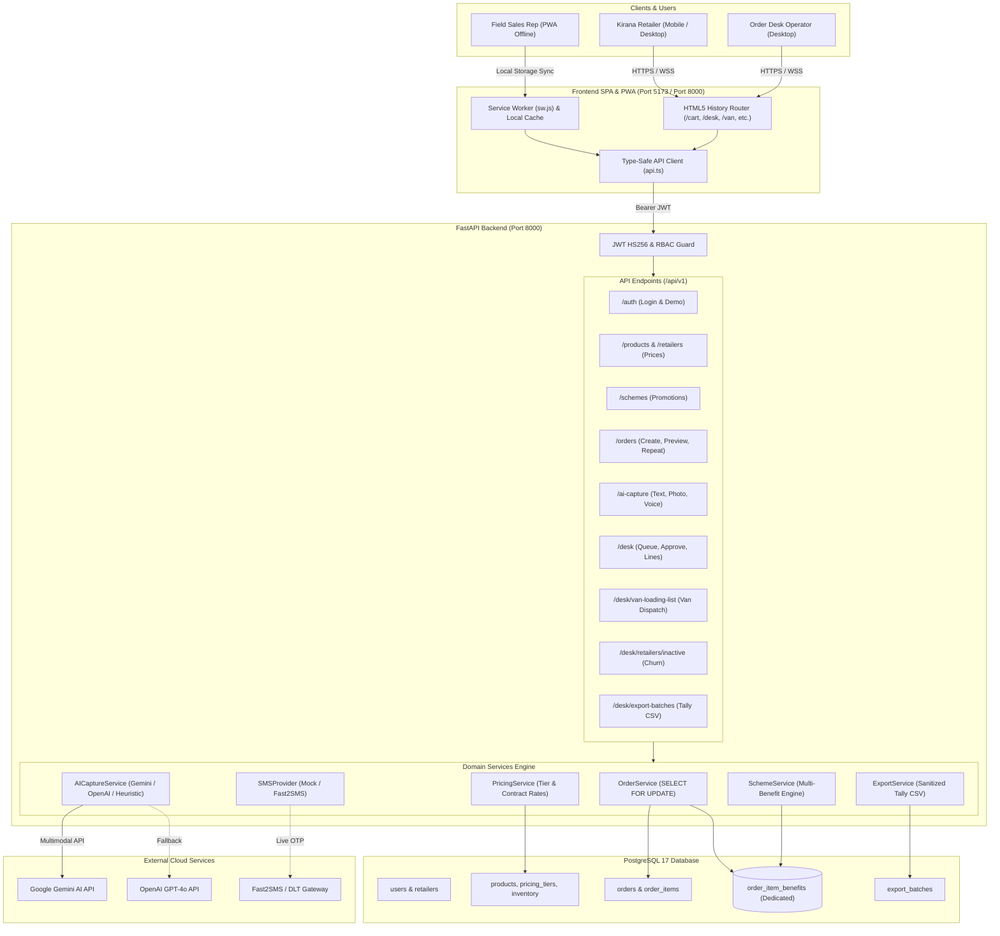

# VyapaarSetu (व्यापार सेतु)

> **AI-Powered FMCG B2B Wholesale Ordering & Distribution Platform**  
> *Connecting Kirana Retailers and Wholesale Distributors in Jabalpur, Madhya Pradesh*

---

## A. Project Introduction

**VyapaarSetu** ("Bridge of Commerce") is an AI-assisted B2B ordering and distribution management platform tailored specifically for fast-moving consumer goods (FMCG) distributors and independent kirana retailers in Tier-2/Tier-3 Indian markets (specifically Jabalpur, MP).

Traditional kirana order collection relies heavily on fragmented WhatsApp voice notes, handwritten paper slips, and informal physical visits by field sales reps. This leads to costly errors, lost trade schemes, stock mismatches, and delayed delivery dispatches.

VyapaarSetu digitises and streamlines this end-to-end distribution cycle:
- **Retailer Ordering:** Digital self-serve catalogue with instant order placement and repeat order revalidation.
- **Master Catalogue & Dynamic Pricing:** Tiered dealer prices with store-specific custom contract overrides.
- **Trade Promotion Scheme Engine:** Evaluates volume thresholds, trade promotions, and multi-benefit free goods without merging different product lines.
- **AI-Assisted Order Capture:** Transcribes Hindi/Hinglish audio, OCRs handwritten slips, and parses WhatsApp text with human confirmation guards.
- **Order Management & Concurrency:** Pessimistic locking (`SELECT FOR UPDATE`) prevents overselling under high concurrency.
- **Credit Exposure Review:** Real-time credit limits, outstanding balances, and credit hold workflows.
- **Tally Prime Accounting Export:** Sanitized CSV batch exports with distinct free goods lines (`Billed Qty = 0.00`, `Rate = 0.00`).
- **Warehouse Loading Operations:** Daily van loading lists aggregating approved orders by SKU code and case totals.
- **Field Sales & PWA:** Offline-capable Progressive Web App enabling field reps to take orders without continuous internet connectivity.

---

## B. Key Features

### Retailer Workflows
| Feature | Status | Description |
|---|---|---|
| **OTP Authentication** | `Implemented` | Phone-based login with OTP verification, rate limits (3/min), and brute-force lockout (5 attempts / 15 min). |
| **Product Catalogue** | `Implemented` | 3 core FMCG product lines (Biscuits, Detergents, Tea) with real-time case availability indicators. |
| **Retailer-Specific Pricing** | `Implemented` | Store-specific contract rates dynamically applied over default dealer tiers. |
| **Cart & Order Placement** | `Implemented` | Add cases to cart, live order total preview, and real-time credit limit checking. |
| **Multi-Benefit Scheme Visibility** | `Implemented` | Badges on product cards and dedicated promo rows in cart displaying all awarded free goods. |
| **Order History & Lifecycle Tracking** | `Implemented` | Tracks status across `SUBMITTED`, `APPROVED`, `DISPATCHED`, `DELIVERED`, and `REJECTED`. |
| **Repeat Ordering** | `Implemented` | One-click order reload with live catalog revalidation modal detecting price, stock, and scheme diffs. |
| **AI Text Capture** | `Implemented` | Natural language order parsing for Hindi, Hinglish, and English WhatsApp text strings. |
| **AI Photo Capture (OCR)** | `Implemented` | Upload handwritten slips (JPEG/PNG/WebP $\le$ 10MB) for automated line extraction. |
| **AI Voice Capture** | `Implemented` | In-browser live audio recording (or upload $\le$ 25MB) with Hindi/Hinglish transcription. |

### Order Desk Workflows
| Feature | Status | Description |
|---|---|---|
| **Incoming Order Queue** | `Implemented` | Central dashboard filtering pending orders by status (`SUBMITTED`, `CREDIT_HOLD`, `APPROVED`). |
| **Order Review & Approval** | `Implemented` | Line-item inspection, quantity adjustments with automatic scheme recalculation, and one-click approval. |
| **Credit Holds & Overrides** | `Implemented` | Orders exceeding credit limits are automatically placed on `CREDIT_HOLD` with explicit desk override authority. |
| **Stock Validation & Reservation** | `Implemented` | Atomic case reservations upon order approval using database row locks (`SELECT FOR UPDATE`). |
| **Scheme Recalculation** | `Implemented` | Authoritative server-side scheme re-evaluation whenever quantities are modified at the desk. |
| **Tally Prime CSV Export** | `Implemented` | Generates accounting batches with CSV injection sanitization (`'`, `=`, `+`, `-`, `@`) and zero-rated promo lines. |
| **Van Loading Lists** | `Implemented` | Aggregates daily deliveries by SKU code with store breakdowns and dedicated CSV export. |
| **Retailer Inactivity Reporting** | `Implemented` | Audits kirana accounts with no orders in past $N$ days (default 14) with search, pagination, and CSV export. |

### Platform Architecture & Security
| Feature | Status | Description |
|---|---|---|
| **Role-Based Access Control (RBAC)** | `Implemented` | Strict separation between `ROLE_RETAILER` and `ROLE_ORDER_DESK` via JWT claims. |
| **PostgreSQL 17 Persistence** | `Implemented` | Fully relational async schema with foreign keys, checks, and unique indexes managed by Alembic. |
| **AI Provider Fallback Engine** | `Implemented` | Primary Google Gemini 3.5, fallback OpenAI GPT-4o, and reliable local heuristic regex parser. |
| **PWA & Offline Salesman Mode** | `Implemented` | Web manifest, service worker caching, local `localStorage` queue, and idempotent sync (`client_order_id`). |
| **Deep-Link URL Routing** | `Implemented` | Direct URL navigation (`/login`, `/catalogue`, `/cart`, `/ai`, `/orders`, `/desk`, `/van`, `/inactivity`, `/exports`). |
| **Live SMS Gateway** | `Partially implemented` | `MockSMSProvider` active in development (`123456`). `LiveFast2SMSProvider` implemented; requires API key. |

---

## C. Technology Stack

| Layer | Technology | Version | Purpose |
|---|---|---|---|
| **Frontend Framework** | React | `18.2.0` | Component-based UI with hooks and state management |
| **Frontend Language** | TypeScript | `5.2.2` | Static typing, domain model definitions, and API client types |
| **Frontend Build Tool** | Vite | `5.1.6` | Fast HMR development server and production bundler |
| **Frontend Styling** | Tailwind CSS | `3.4.1` | Dark-forest FMCG theme and utility-first layout |
| **Icons & UI** | Lucide React | `0.359.0` | Production icon set |
| **Routing** | React Router DOM | `6.22.3` | SPA routing and HTML5 History API integration |
| **Backend Framework** | FastAPI | `0.115.0+` | High-performance asynchronous Python REST API |
| **Backend Language** | Python | `3.12` | Core backend runtime |
| **ASGI Server** | Uvicorn | `0.32.0+` | Asynchronous production server |
| **ORM** | SQLAlchemy (asyncio) | `2.0.36+` | Asynchronous relational data access and query builder |
| **Database Driver** | asyncpg | `0.30.0+` | High-performance asynchronous PostgreSQL client |
| **Database Migrations** | Alembic | `1.14.0+` | Database schema migrations and revision tracking |
| **Database** | PostgreSQL | `17` / `16-alpine` | ACID relational database with row-level locking |
| **Validation & Settings** | Pydantic v2 & Pydantic-Settings | `2.9.0+` | Request/response schema validation and `.env` loading |
| **Authentication** | PyJWT / python-jose | `2.9.0+` | JWT generation, verification, and claims decoding (HS256) |
| **AI Providers** | Google Gemini / OpenAI | SDK / API | Multimodal multimodal OCR, audio transcription, text parsing |
| **Containerization** | Docker & Docker Compose | `24.0+` | Multi-container development and production orchestration |

---

## D. Architecture



---

## E. Repository Structure

```text
VyapaarSetu/
├── .env.example                       # Complete sanitized environment variable template
├── .gitignore                         # Git ignore list (excludes pgdata, node_modules, .env)
├── docker-compose.yml                 # Local multi-container Docker specification
├── package.json                       # Root script helper package
├── README.md                          # Main project documentation (this file)
├── deployment.md                      # Production deployment & operations guide
├── PROJECT_AUDIT.md                   # Formal audit & verification baseline (v3.0.0)
│
├── backend/                           # FastAPI Backend Application
│   ├── alembic/                       # Alembic database migrations
│   │   ├── env.py                     # Async SQLAlchemy Alembic runner
│   │   └── versions/                  # Migration revision files
│   │       ├── 4e317dd8e50a_initial_phase2_schema.py
│   │       ├── 7a8b9c0d1e2f_add_product_images.py
│   │       └── d93a11c7f5a1_snapshot_free_goods.py   # Head: order_item_benefits table
│   ├── alembic.ini                    # Alembic configuration
│   ├── app/                           # Application source code
│   │   ├── main.py                    # ASGI app entry point & SPA static file serving
│   │   ├── api/v1/                    # API v1 route endpoints
│   │   │   ├── router.py              # Root v1 APIRouter
│   │   │   └── endpoints/             # Subsystem endpoint handlers
│   │   │       ├── ai_capture.py      # Text, photo, voice order capture
│   │   │       ├── auth.py            # Phone login, demo login, session info
│   │   │       ├── desk.py            # Order desk, van lists, retailer inactivity
│   │   │       ├── exports.py         # Tally Prime CSV exports
│   │   │       ├── health.py          # Database and TCP health check
│   │   │       ├── orders.py          # Cart preview, order placement, repeat order
│   │   │       ├── products.py        # Catalogue browse & stock levels
│   │   │       ├── retailers.py       # Retailer profile & custom pricing
│   │   │       └── schemes.py         # Active trade promotional schemes
│   │   ├── core/                      # Core configuration and database engine
│   │   │   ├── config.py              # Pydantic v2 Settings class
│   │   │   ├── database.py            # async_sessionmaker & engine initialization
│   │   │   └── security.py            # Password hashing & JWT token issuance
│   │   ├── models/                    # SQLAlchemy declarative models
│   │   │   ├── auth.py                # User and Role models
│   │   │   ├── catalog.py             # Product, PricingTier, Inventory, RetailerPrice
│   │   │   ├── export.py              # ExportBatch model
│   │   │   ├── order.py               # Order, OrderItem, and OrderItemBenefit
│   │   │   ├── retailer.py            # Retailer profile model
│   │   │   └── scheme.py              # Scheme and SchemeCondition models
│   │   ├── schemas/                   # Pydantic data validation schemas
│   │   ├── seeds/                     # Synthetic seed data
│   │   │   └── demo_data.py           # Master database seeder for Jabalpur FMCG products
│   │   └── services/                  # Business logic services
│   │       ├── ai_capture_service.py  # Gemini/OpenAI/local regex order extraction
│   │       ├── credit_service.py      # Credit limit verification
│   │       ├── export_service.py      # Tally Prime CSV generator with injection defense
│   │       ├── inventory_service.py   # Stock allocation and verification
│   │       ├── order_service.py       # Atomic order lifecycle with row-level locks
│   │       ├── pricing_service.py     # Retailer-specific pricing calculation
│   │       ├── scheme_service.py      # Multi-benefit free goods evaluation engine
│   │       └── sms_service.py         # SMSProvider interface & MockSMSProvider
│   ├── pyproject.toml                 # Backend project metadata & pytest configuration
│   ├── pytest.ini                     # Pytest runner settings
│   ├── requirements.txt               # Locked backend dependencies
│   └── tests/                         # Automated test suite (69 tests)
│
└── frontend/                          # React 18 / 19 + TypeScript Application
    ├── index.html                     # HTML5 entry with PWA manifest & SW registration
    ├── package.json                   # Frontend scripts and dependencies
    ├── postcss.config.js              # PostCSS configuration for Tailwind
    ├── tailwind.config.js             # Custom Tailwind palette (emerald/forest theme)
    ├── tsconfig.json                  # TypeScript compiler settings
    ├── vite.config.ts                 # Vite bundler configuration & local API proxy
    ├── public/                        # Static assets
    │   ├── manifest.webmanifest       # PWA web application manifest
    │   ├── sw.js                      # Service Worker caching script
    │   └── images/                    # Product imagery & PWA SVG icons
    └── src/                           # Application source code
        ├── main.tsx                   # React root entry point
        ├── App.tsx                    # Complete unified FMCG wholesale frontend
        ├── api.ts                     # Type-safe API client & offline queue manager
        ├── types/                     # TypeScript domain models
        └── index.css                  # Global styles and custom animations
```

---

## F. Prerequisites

Ensure the following tools are installed on your local host:

1. **Python 3.12** (Python $\ge$ 3.11 required): [python.org](https://www.python.org/downloads/)
2. **Node.js 20 LTS** (Node $\ge$ 18 required): [nodejs.org](https://nodejs.org/)
3. **PostgreSQL 17** (or PostgreSQL 16 via Docker): [postgresql.org](https://www.postgresql.org/download/)
4. **Git**: [git-scm.com](https://git-scm.com/)

---

## G. Local Installation

### Windows PowerShell

#### 1. Clone & Setup Repository
```powershell
git clone https://github.com/Surendra571/VyapaarSetu.git
cd VyapaarSetu
```

#### 2. Configure Environment Variables
```powershell
Copy-Item .env.example .env
# Edit .env in Notepad or your editor to verify POSTGRES_PASSWORD and credentials:
notepad .env
```

#### 3. Setup Python Backend Virtual Environment
```powershell
cd backend
python -m venv venv
.\venv\Scripts\Activate.ps1
python -m pip install --upgrade pip
pip install -r requirements.txt
```

#### 4. Setup Database & Run Migrations
Ensure local PostgreSQL is running on port `5432` with a database named `vyapaarsetu_db`:
```powershell
# Create database if not already existing:
# psql -U postgres -c "CREATE DATABASE vyapaarsetu_db;"

# Run Alembic migrations to head:
alembic upgrade head

# Seed master FMCG catalogue & demo accounts:
python -m app.seeds.demo_data
```

#### 5. Start Backend Server
```powershell
uvicorn app.main:app --host 127.0.0.1 --port 8000 --reload
```
*The backend API is now running at `http://127.0.0.1:8000` (Swagger docs at `http://127.0.0.1:8000/docs`).*

#### 6. Setup and Start Frontend (In a New Terminal)
```powershell
cd d:\BACKEND-2026\VyapaarSetu\frontend
npm install
npm run dev
```
*The frontend is now running at `http://127.0.0.1:5173`.*

---

### Linux / macOS

```bash
# 1. Clone repository
git clone https://github.com/Surendra571/VyapaarSetu.git
cd VyapaarSetu

# 2. Configure environment
cp .env.example .env

# 3. Setup backend
cd backend
python3 -m venv venv
source venv/bin/activate
pip install --upgrade pip
pip install -r requirements.txt

# 4. Migrate and seed database
alembic upgrade head
python3 -m app.seeds.demo_data

# 5. Start backend
uvicorn app.main:app --host 127.0.0.1 --port 8000 --reload &

# 6. Setup and start frontend
cd ../frontend
npm install
npm run dev
```

---

## H. Environment Variables

All settings are managed via `.env` in the project root or system environment:

| Variable Name | Required | Default / Example Value | Server Only | Purpose |
|---|---|---|---|---|
| `ENVIRONMENT` | Yes | `development` | Yes | Sets runtime mode (`development`, `staging`, `production`) |
| `DEBUG` | Yes | `True` (dev) / `False` (prod) | Yes | Enables detailed logging and SQL echo when True |
| `APP_NAME` | No | `VyapaarSetu` | Yes | Application identifier |
| `APP_HOST` | No | `0.0.0.0` | Yes | Listening IP interface |
| `APP_PORT` | No | `8000` | Yes | Listening HTTP port |
| `SECRET_KEY` | **Yes** | *Cryptographic 64-char hex* | Yes | Secret key for JWT signing (HS256) |
| `ACCESS_TOKEN_EXPIRE_MINUTES` | No | `1440` (24 hours) | Yes | JWT session validity duration |
| `ALGORITHM` | No | `HS256` | Yes | Cryptographic algorithm for JWT |
| `POSTGRES_USER` | Yes | `postgres` | Yes | PostgreSQL username |
| `POSTGRES_PASSWORD` | **Yes** | *Your secure DB password* | Yes | PostgreSQL password |
| `POSTGRES_HOST` | Yes | `127.0.0.1` | Yes | PostgreSQL host address |
| `POSTGRES_PORT` | Yes | `5432` | Yes | PostgreSQL port |
| `POSTGRES_DB` | Yes | `vyapaarsetu_db` | Yes | PostgreSQL database name |
| `DATABASE_URL` | **Yes** | `postgresql+asyncpg://...` | Yes | Complete asyncpg database connection string |
| `CORS_ORIGINS` | **Yes** | `http://localhost:5173,...` | Yes | Comma-separated list of allowed frontend origins |
| `AI_PROVIDER` | No | `auto` | Yes | AI engine (`auto`, `gemini`, `openai`) |
| `GEMINI_API_KEY` | Optional | `your_gemini_api_key` | Yes | Google Gemini API key for OCR/voice/text capture |
| `GEMINI_MODEL` | No | `gemini-3.5-flash-lite` | Yes | Target Gemini model |
| `OPENAI_API_KEY` | Optional | `your_openai_api_key` | Yes | OpenAI API key for fallback text/audio capture |
| `FAST2SMS_API_KEY` | Optional | `your_fast2sms_api_key` | Yes | Live SMS gateway key (activates `LiveFast2SMSProvider`) |
| `ALLOW_SCHEME_STACKING` | No | `False` | Yes | Policy whether multiple promotions stack on one line |
| `SCHEME_STACKING_POLICY` | No | `FLAG_CONFLICT_FOR_REVIEW` | Yes | Conflict resolution mode |
| `STRICT_CREDIT_HOLD` | No | `True` | Yes | Blocks checkout if order exceeds available credit |
| `INSUFFICIENT_STOCK_POLICY`| No | `REJECT_ORDER` | Yes | Rejection policy when stock is insufficient |
| `VITE_API_BASE_URL` | No | `http://localhost:8000/api/v1` | **No** (Vite) | Client-side base URL for backend API requests |

> [!CAUTION]
> Never set private keys (`SECRET_KEY`, `POSTGRES_PASSWORD`, `GEMINI_API_KEY`, etc.) with the `VITE_` prefix, as Vite embeds `VITE_` variables directly into public browser JavaScript bundles.

---

## I. Demo Credentials

The following synthetic accounts are pre-configured by `python -m app.seeds.demo_data`:

| Portal Role | Phone Number | Demo OTP | Assigned Business Entity | Notes |
|---|---|---|---|---|
| **Kirana Retailer** | `9826011111` | `123456` | Sharma Kirana Store (Gorakhpur, Jabalpur) | Credit limit: ₹50,000; Custom biscuit discount: ₹80.00/case |
| **Kirana Retailer** | `9826022222` | `123456` | Gupta General Stores (Adhartal, Jabalpur) | Credit limit: ₹35,000; Standard dealer tier |
| **Order Desk Operator** | `9826000000` | `123456` | Jabalpur Central FMCG Distribution Hub | Full desk authority: approve orders, edit lines, view van lists, export Tally batches |

> [!NOTE]
> Demo OTP `123456` is strictly restricted to development and evaluation environments. Production deployments must provide `FAST2SMS_API_KEY` to enforce dynamic, cryptographically generated 6-digit OTP delivery.

---

## J. API Documentation

When the backend server is running, interactive API documentation is automatically available:

- **Swagger UI (Interactive API Explorer):** [`http://127.0.0.1:8000/docs`](http://127.0.0.1:8000/docs)
- **ReDoc (Technical API Reference):** [`http://127.0.0.1:8000/redoc`](http://127.0.0.1:8000/redoc)
- **OpenAPI JSON Specification:** [`http://127.0.0.1:8000/openapi.json`](http://127.0.0.1:8000/openapi.json)
- **System Health Check Endpoint:** [`http://127.0.0.1:8000/api/v1/health`](http://127.0.0.1:8000/api/v1/health)

### Key Endpoint Groups

- **Auth:**
  - `POST /api/v1/auth/login`: Issue OTP verification request.
  - `POST /api/v1/auth/demo-login`: Instant synthetic JWT generation for development.
  - `GET /api/v1/auth/demo-login`: Browser launcher auto-logging in and redirecting to SPA screens.
  - `GET /api/v1/auth/me`: Retrieve authenticated user profile and retailer metadata.
- **Catalogue & Pricing:**
  - `GET /api/v1/products`: List active SKUs, categories, and inventory case levels.
  - `GET /api/v1/retailers/pricing`: Retrieve effective retailer-specific prices.
  - `GET /api/v1/schemes/active`: Retrieve current trade promotions and free goods criteria.
- **Orders:**
  - `POST /api/v1/orders/preview`: Server-side price, scheme, and credit calculations for cart.
  - `POST /api/v1/orders`: Submit new order with optional `client_order_id` idempotency key.
  - `GET /api/v1/orders`: Retrieve order history with line items and free promotional goods.
  - `POST /api/v1/orders/{id}/repeat-preview`: Revalidate historical order against live catalog.
- **AI Multimodal Capture:**
  - `POST /api/v1/ai-capture/text`: Parse WhatsApp messages into structured order items.
  - `POST /api/v1/ai-capture/photo`: OCR handwritten retailer slips (JPEG/PNG/WebP $\le$ 10MB).
  - `POST /api/v1/ai-capture/voice`: Transcribe Hindi/Hinglish audio orders (WAV/MP3/M4A $\le$ 25MB).
  - `POST /api/v1/ai-capture/{session_id}/confirm`: Confirm lines and hydrate shopping cart.
- **Order Desk Operations:**
  - `GET /api/v1/desk/orders`: View full pending dispatch queue.
  - `PATCH /api/v1/desk/orders/{order_id}/lines/{item_id}`: Adjust line quantities with authoritative scheme recalculation.
  - `POST /api/v1/desk/orders/{id}/approve`: Atomically reserve stock and approve order.
  - `GET /api/v1/desk/van-loading-list`: Consolidated daily SKU dispatch list (+ CSV export).
  - `GET /api/v1/desk/retailers/inactive`: Identify dormant kirana accounts (>14 days) (+ CSV export).
  - `POST /api/v1/desk/export-batches`: Generate sanitized Tally Prime XML/CSV batches.

---

## K. Automated Testing & Verification

The repository includes a comprehensive automated test suite with **69 backend tests passing** and a clean TypeScript build.

### Run All Backend Tests
```powershell
cd backend
python -m pytest tests -v
```

### Run Specific Test Modules
```powershell
# Multi-Benefit Scheme Engine Tests (13 tests)
python -m pytest tests/test_multi_benefit_scheme.py -v

# Core API Lifecycle & Concurrency Tests (14 tests)
python -m pytest tests/test_api_v1.py -v

# AI Multimodal Capture & Van Loading Tests (15 tests)
python -m pytest tests/test_phase5_business_and_ai.py -v

# Security, Rate Limiting & Input Sanitization Tests (11 tests)
python -m pytest tests/test_phase6_security.py -v

# Edge Cases & Churn Reporting Tests (8 tests)
python -m pytest tests/test_phase7_additional_qa.py -v
```

### Run Frontend TypeScript Check & Production Build
```powershell
cd frontend
# Check TypeScript compilation:
npx tsc --noEmit

# Run Vite production build:
npm run build
```

---

## L. Screenshots & Visual Assets

Actual product media and branding assets included in the repository:

- **Product Imagery:**
  - Parle-G 75g Biscuits (`/images/products/SKU-BS-075.png`)
  - Ghadi 1kg Detergent Powder (`/images/products/SKU-DT-1KG.png`)
  - Wagh Bakri 250g Tea (`/images/products/SKU-TE-250.png`)
- **PWA Icons:**
  - App Icon 192x192 SVG (`/images/icon-192.svg`)
  - App Icon 512x512 SVG (`/images/icon-512.svg`)

---

## M. Current Limitations & Known Scope

To maintain complete operational transparency, the following technical boundaries are noted:

1. **SMS Gateway:** By default, the application runs with `MockSMSProvider` using demo OTP `123456`. Real SMS dispatch requires setting `FAST2SMS_API_KEY` with an active Indian DLT registered sender ID.
2. **AI Provider Quotas:** When external Gemini or OpenAI API keys are not supplied or rate-limited, the system falls back to a deterministic local regex parser. Ambiguous units (e.g. "peti" vs "piece") require manual confirmation.
3. **Database Architecture:** Built for PostgreSQL 17 with `asyncpg`. In-memory SQLite is not supported for production concurrent operations due to row-level `SELECT FOR UPDATE` locking constraints.
4. **GST Tax Model:** In accordance with Jabalpur local FMCG wholesale conventions for baseline staples, rates are quoted excluding GST, or under zero-rated composition schemes.

---

## N. Contribution & Licence

### Contributing
1. Fork the repository and create a feature branch (`git checkout -b feature/your-feature`).
2. Verify all 69 backend tests pass (`python -m pytest tests`).
3. Run `npm run build` in `frontend/` to ensure zero TypeScript errors.
4. Submit a Pull Request with a clear description of your changes.

### Licence
This repository does not currently contain an open-source licence file. All rights are reserved by the original project authors. For commercial or distribution rights, contact the repository maintainers.
