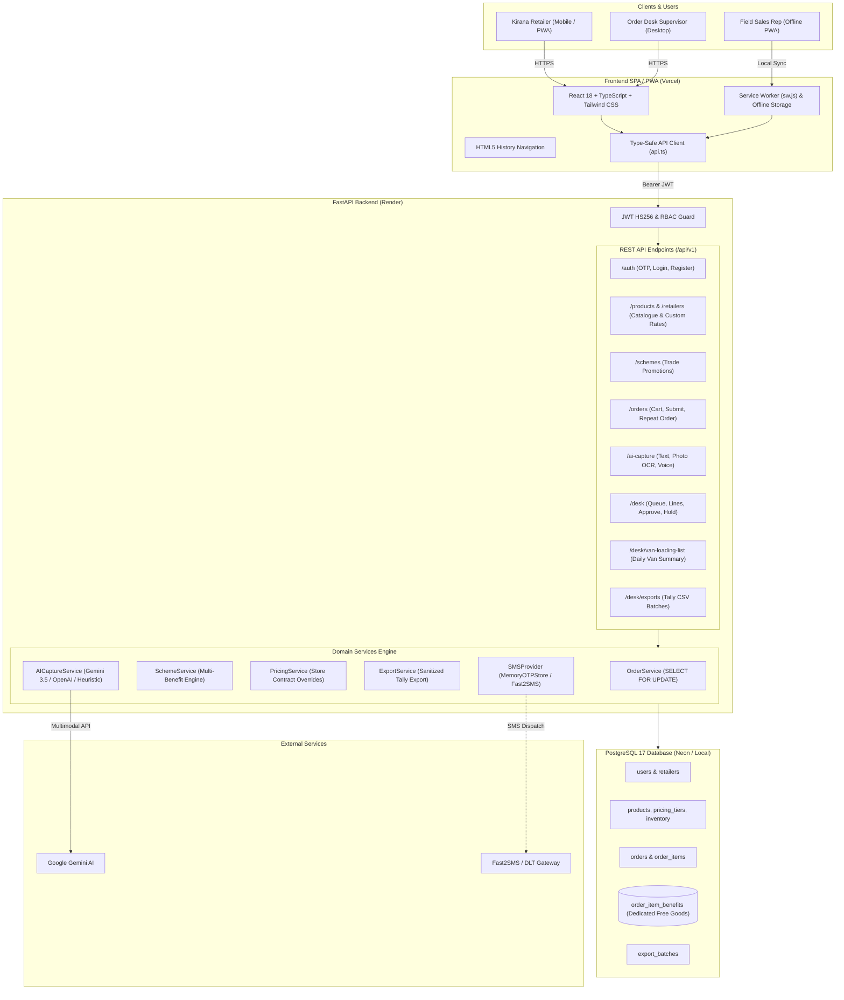

# VyapaarSetu (व्यापार सेतु)

> **Enterprise B2B FMCG Wholesale Ordering & Distribution Platform**  
> *Connecting Kirana Retailers and Wholesale Distributors in Jabalpur, Madhya Pradesh*

[](https://vyapaar-setu-ashen.vercel.app)
[](https://vyapaarsetu-2.onrender.com/api/v1/health)
[](https://github.com/Surendra571/VyapaarSetu)
[](https://vyapaar-setu-ashen.vercel.app)

---

## Live Deployments

| Component | Target URL | Description |
| :--- | :--- | :--- |
| **Production Web App** | [https://vyapaar-setu-ashen.vercel.app](https://vyapaar-setu-ashen.vercel.app) | Responsive PWA/SPA for Retailers and Order Desk |
| **Backend REST API** | [https://vyapaarsetu-2.onrender.com](https://vyapaarsetu-2.onrender.com) | FastAPI 0.115 asynchronous production backend |
| **Health Check** | [https://vyapaarsetu-2.onrender.com/api/v1/health](https://vyapaarsetu-2.onrender.com/api/v1/health) | Live latency, DB connectivity & system diagnostics |
| **Interactive API Docs** | [https://vyapaarsetu-2.onrender.com/docs](https://vyapaarsetu-2.onrender.com/docs) | OpenAPI 3.1 / Swagger UI explorer |

---

## 1. Executive Summary

**VyapaarSetu** ("Bridge of Commerce") is an enterprise B2B ordering and distribution management system engineered specifically for fast-moving consumer goods (FMCG) distributors and independent kirana retailers in Tier-2/Tier-3 Indian markets (modeled after Jabalpur, MP).

Traditional kirana order booking is bottlenecked by informal, error-prone workflows: fragmented WhatsApp voice messages, handwritten slips, and delayed weekly salesman visits. This results in billing disputes, lost trade promotion schemes, inventory mismatches, and delayed delivery cycles.

VyapaarSetu provides a full-stack, enterprise-grade digital distribution solution:
- **Clean Production-Ready State:** The platform boots with active master catalog products, inventory, prices, trade schemes, and verified accounts, with **zero pre-populated sample orders**. Both the Retailer Order History and Order Desk queues start in clean empty states (`No orders yet`), ready for real-time order capture.
- **Mobile OTP Authentication & Self-Registration:** Any kirana owner can sign in or self-register via 10-digit mobile number and verified OTP, instantly unlocking an initial ₹50,000 credit line. One-click quick demo access chips remain available for rapid evaluation.
- **Master Catalogue & Dynamic Tiered Pricing:** Real-time stock visibility across core FMCG categories (Biscuits, Detergents, Tea) with store-specific contract overrides applied dynamically over default dealer pricing.
- **Deterministic Multi-Benefit Scheme Engine:** Automatically evaluates volume tiers, percentage discounts, and promotional free goods (e.g., *Buy 10 Cases Biscuit Get 1 Case Free*), maintaining distinct free goods line items without altering purchased quantities.
- **Multimodal AI Order Capture:** Extracts structured line items from informal WhatsApp messages, handwritten slips (OCR), or Hindi/Hinglish audio notes with mandatory human-in-the-loop review and invalid file format guardrails.
- **Pessimistic Concurrency & Credit Control:** Atomic stock reservations using PostgreSQL row-level locks (`SELECT FOR UPDATE`) and real-time credit limit verification with automated `CREDIT_HOLD` safeguards.
- **Tally Prime Accounting Export:** Sanitized CSV batch generator with CSV formula injection protection (`'`, `=`, `+`, `-`, `@`) and separate zero-rated rows for promotional goods.
- **Warehouse Loading & Van Lists:** Aggregated dispatch lists grouped by SKU code with store destination breakdowns for streamlined morning van loading.

---

## 2. System Architecture



---

## 3. Technology Stack

| Layer | Technology | Version | Purpose |
| :--- | :--- | :--- | :--- |
| **Frontend Framework** | React | `18.2.0` | Component-driven UI architecture |
| **Frontend Language** | TypeScript | `5.2.2` | End-to-end type safety and domain models |
| **Bundler & Tooling** | Vite | `5.1.6` | High-speed production bundling |
| **Styling** | Tailwind CSS | `3.4.1` | Responsive emerald theme, mobile-first design |
| **Icons** | Lucide React | `0.359.0` | Production vector iconography |
| **Backend Framework** | FastAPI | `0.115.0+` | High-performance asynchronous REST API |
| **Backend Language** | Python | `3.12` | Modern async Python runtime |
| **ASGI Server** | Uvicorn | `0.32.0+` | Production asynchronous ASGI server |
| **ORM & Query Engine** | SQLAlchemy (asyncio) | `2.0.36+` | Non-blocking relational ORM and query builder |
| **Database Driver** | asyncpg | `0.30.0+` | Asynchronous PostgreSQL connection pool |
| **Database Migrations**| Alembic | `1.14.0+` | Schema migration history and revisions |
| **Database** | PostgreSQL | `17` / `16-alpine` | Relational ACID database with row-level locking |
| **Validation & Config** | Pydantic v2 | `2.9.0+` | Strict schema validation and typed settings |
| **Authentication** | PyJWT / python-jose | `2.9.0+` | HS256 signed JWT tokens with RBAC claims |
| **AI Providers** | Google Gemini / OpenAI | SDK / API | Multimodal OCR, audio transcription, order extraction |

---

## 4. Key Workflows & Features

### A. Authentication & Onboarding
- **App/Website-Styled Portal:** Intuitive segmented switcher between **Sign In** and **Create Account**.
- **Mobile OTP Verification:** Dispatches 6-digit OTP code with a 30-second resend countdown timer and retry rate limiting.
- **Kirana Self-Registration:** Allows any new retailer to register by providing owner name, store name, mobile number, city, and address. Upon verification, the system creates the retailer profile with an instant ₹50,000 credit line.
- **Quick Demo Access:** Preserved 1-click login chips for instant evaluator access:
  - **Ramesh Patel** &mdash; Retailer (*Patel Kirana*, `9826011111`)
  - **Sanjay Sharma** &mdash; Order Desk Supervisor (`9826000000`)

### B. Master Catalogue & Pricing
- **3 Core FMCG Product Lines:** Glucose Biscuits 75g (`SKU-BS-075`), Detergent Powder 1kg (`SKU-DT-1KG`), and Premium CTC Tea 250g (`SKU-TE-250`).
- **Dynamic Dealer Rates:** Tiered pricing engine with custom contract rates applied automatically per store.
- **Case Availability Indicators:** Real-time stock status badges (`In Stock`, `Low Stock`, `Out of Stock`).

### C. Multi-Benefit Trade Promotion Scheme Engine
- Evaluates qualifying quantities deterministically.
- Supports volume discounts and separate free promotional goods lines without merging distinct SKUs.
- Recalculates promotions automatically whenever order lines or quantities are modified at the Order Desk.

### D. Multimodal AI Order Capture
- **WhatsApp Text Parsing:** Extracts SKU codes, quantities, and units from Hindi, Hinglish, and English text.
- **Handwritten Slip OCR:** Extracts line items from photos of order notebooks (JPEG/PNG/WebP $\le$ 10MB).
- **Hindi Voice Note Transcription:** Live microphone recording or audio file upload (MP3/WAV/WebM $\le$ 25MB) with natural language entity recognition.
- **Human-in-the-Loop Confirmation:** Highlighting ambiguous units (e.g. *peti* vs *piece*) and requiring explicit retailer confirmation before cart insertion.

### E. Order Desk Operations & Delivery Management
- **Empty-Queue Start:** Displays clean empty states in production until new orders are submitted by retailers.
- **Credit Exposure Review:** Real-time verification of outstanding balances against credit limits, with automatic `CREDIT_HOLD` and supervisor override capability.
- **Van Loading Lists:** Aggregated daily delivery requirements by SKU with store destination breakdowns and downloadable CSV.
- **Tally Prime CSV Export:** Sanitized CSV batch exports preventing formula injection attacks (`'`, `=`, `+`, `-`, `@`), with promotional free lines marked at `Billed Qty = 0.00` and `Rate = 0.00`.

---

## 5. Repository Structure

```text
VyapaarSetu/
├── .env.example                       # Complete sanitized environment configuration template
├── .gitignore                         # Git ignore list
├── docker-compose.yml                 # Multi-container Docker configuration
├── package.json                       # Root script orchestrator
├── README.md                          # Enterprise documentation (this file)
├── deployment.md                      # Production deployment guide
├── PROJECT_FINAL_VERIFICATION.md      # Independent verification & audit report
│
├── backend/                           # FastAPI Backend Application
│   ├── alembic/                       # Database migrations
│   │   ├── env.py                     # Async migration runner
│   │   └── versions/                  # Schema migration revisions
│   ├── alembic.ini                    # Alembic settings
│   ├── app/                           # Backend application source code
│   │   ├── main.py                    # ASGI entry point & static SPA mounting
│   │   ├── api/v1/                    # API v1 routes
│   │   │   ├── endpoints/             # Subsystem route handlers
│   │   │   │   ├── ai_capture.py      # Text, photo, voice order capture
│   │   │   │   ├── auth.py            # OTP sign-in, registration, demo tokens
│   │   │   │   ├── desk.py            # Order desk queue, van lists, sample data reset
│   │   │   │   ├── exports.py         # Tally Prime CSV exports
│   │   │   │   ├── health.py          # Database and service health check
│   │   │   │   ├── orders.py          # Cart preview, order placement, repeat order
│   │   │   │   ├── products.py        # Catalogue browse & stock levels
│   │   │   │   ├── retailers.py       # Retailer profile & custom pricing
│   │   │   │   └── schemes.py         # Active trade promotions
│   │   │   └── router.py              # Root API v1 router
│   │   ├── core/                      # Core configuration and database engine
│   │   │   ├── config.py              # Pydantic v2 Settings
│   │   │   ├── database.py            # Async engine and session factory
│   │   │   └── security.py            # JWT token issuance and verification
│   │   ├── models/                    # Declarative SQLAlchemy models
│   │   ├── schemas/                   # Pydantic validation schemas
│   │   ├── seeds/                     # Production master data & management scripts
│   │   │   ├── demo_data.py           # Master catalogue, inventory, and accounts seeder
│   │   │   └── clear_orders.py        # Reset orders to clean empty production state
│   │   └── services/                  # Business logic engines
│   ├── pytest.ini                     # Pytest runner settings
│   ├── requirements.txt               # Locked backend dependencies
│   └── tests/                         # Automated test suite (69 passing tests)
│
└── frontend/                          # React 18 + TypeScript Application
    ├── index.html                     # HTML5 entry with PWA manifest & SW registration
    ├── package.json                   # Dependencies and build scripts
    ├── postcss.config.js              # PostCSS configuration for Tailwind
    ├── tailwind.config.js             # Emerald forest theme palette
    ├── tsconfig.json                  # TypeScript compiler settings
    ├── vite.config.ts                 # Vite bundler configuration
    ├── public/                        # Static assets, PWA manifest, and product photos
    └── src/                           # Application source code
        ├── main.tsx                   # React root entry point
        ├── App.tsx                    # Unified responsive FMCG workspace
        ├── api.ts                     # Type-safe API client & offline sync manager
        ├── types/                     # TypeScript domain models
        └── index.css                  # Global styles & responsive design
```

---

## 6. Local Setup & Installation

### Prerequisites
- **Python 3.12+**
- **Node.js 20 LTS**
- **PostgreSQL 17** (or PostgreSQL 16 via Docker)
- **Git**

### Installation Steps

#### 1. Clone Repository & Setup Environment
```bash
git clone https://github.com/Surendra571/VyapaarSetu.git
cd VyapaarSetu
cp .env.example .env
```

#### 2. Backend Setup
```bash
cd backend
python -m venv venv

# Windows:
.\venv\Scripts\Activate.ps1
# Linux / macOS:
source venv/bin/activate

pip install --upgrade pip
pip install -r requirements.txt

# Run migrations to latest schema head:
alembic upgrade head

# Seed master catalogue, products, inventory, and accounts (No sample orders seeded):
python -m app.seeds.demo_data
```

#### 3. Start Backend Server
```bash
uvicorn app.main:app --host 127.0.0.1 --port 8000 --reload
```
*API will run at `http://127.0.0.1:8000` (Docs: `http://127.0.0.1:8000/docs`).*

#### 4. Frontend Setup
```bash
cd ../frontend
npm install
npm run dev
```
*Frontend runs at `http://127.0.0.1:5173`.*

---

## 7. Environment Variables Reference

| Variable Name | Required | Default / Example Value | Description |
| :--- | :---: | :--- | :--- |
| `ENVIRONMENT` | Yes | `production` / `development` | Runtime environment mode |
| `DEBUG` | Yes | `False` (prod) / `True` (dev) | SQL logging and debug diagnostics |
| `SECRET_KEY` | **Yes** | *Cryptographic 64-char string* | Secret key for JWT signing (HS256) |
| `ACCESS_TOKEN_EXPIRE_MINUTES` | No | `1440` (24 hours) | JWT token lifetime |
| `DATABASE_URL` | **Yes** | `postgresql+asyncpg://...` | Complete asyncpg PostgreSQL connection string |
| `CORS_ORIGINS` | **Yes** | `https://vyapaar-setu-ashen.vercel.app,...`| Permitted client origins |
| `GEMINI_API_KEY` | Optional | `AIzaSy...` | Google Gemini API key for multimodal order parsing |
| `OPENAI_API_KEY` | Optional | `sk-...` | OpenAI API key for fallback capture parsing |
| `FAST2SMS_API_KEY` | Optional | `your_api_key` | Real SMS gateway key for dynamic transactional OTPs |
| `SEED_DEMO_ORDERS` | No | `false` | When `false`, boots with 0 sample orders (empty state) |
| `VITE_API_BASE_URL` | No | `https://vyapaarsetu-2.onrender.com/api/v1`| Client-side API target URL |

---

## 8. Managing Orders & Production Reset

By default, VyapaarSetu boots in a **clean production state with NO sample orders**. 

If test orders have been submitted during evaluation and you wish to wipe them back to zero:

### Via Backend Script:
```bash
cd backend
python -m app.seeds.clear_orders
```

### Via Order Desk API:
Authorized supervisors (`ROLE_ORDER_DESK`) can call:
```http
POST /api/v1/desk/orders/clear-sample-data
Authorization: Bearer <desk_access_token>
```
*This cleans all order records, line items, promotional benefit lines, and export batches, resetting retailer balances to ₹0.00 outstanding.*

---

## 9. Automated Testing & Verification

The project includes an end-to-end automated test suite containing **69 backend tests** and a zero-error TypeScript build:

```bash
# Run all backend tests
cd backend
pytest tests -v

# Verify frontend TypeScript build
cd ../frontend
npm run build
```

---

## 10. Licence & Intellectual Property

Copyright &copy; 2026 VyapaarSetu Project Authors. All rights reserved. Built for competitive evaluation and production deployment in Tier-2/Tier-3 FMCG distribution networks.
