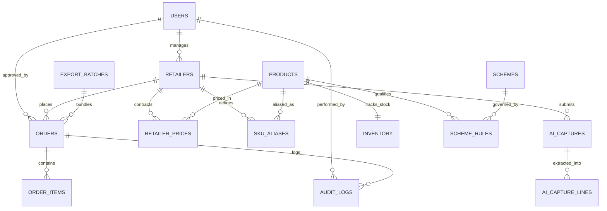
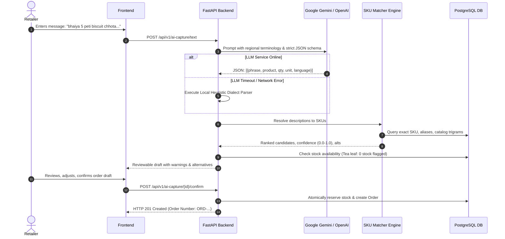

# Technical Design Document (TDD): VyapaarSetu

**Project Name:** VyapaarSetu  
**Target Market:** FMCG Distribution & Wholesale Ordering — Jabalpur, Madhya Pradesh, India  
**Target User Base:** 1,800+ Kirana Stores & FMCG Distributor Order Desk  
**Version:** 1.0.0 (Production-Grade MVP)  
**Date:** November 2026  

---

## 1. Executive Summary & Problem Context

In Jabalpur, India, FMCG distribution to approximately 1,800 neighborhood retail stores (*kirana shops*) historically operated through unorganized, high-friction channels: unstructured WhatsApp messages, handwritten paper lists, and sales agent visits. This process introduced significant operational vulnerabilities:
1. **Transcription & Matching Errors:** Informal Hindi/Hinglish phrasing (e.g., *"5 peti biscuit chhota"*, *"2 peti washing powder 1 kilo"*) required manual interpretation, leading to SKU dispatch errors.
2. **Pricing Discrepancies:** FMCG distributors operate on complex retailer-specific pricing tiers and dynamic trade schemes (e.g., *"Buy 10 cases get 1 free"* or *"3% slab discount on $\ge 5$ cases"*). Manual calculation led to margin leakage.
3. **Inventory & Credit Bottlenecks:** Orders were written without real-time inventory visibility or credit limit validation, causing dispatches against exhausted stock or uncollectible receivables.
4. **ERP Sync Delay:** Confirmed orders required manual re-entry into Tally Prime/ERP 9, adding up to 24–48 hours of dispatch delay.

**VyapaarSetu** solves these challenges by providing a modular, containerized, AI-powered B2B commerce platform. It integrates:
- Real-time catalog and tier-based dealer pricing.
- An automated backend Scheme Engine with strict stacking governance.
- Hybrid LLM-powered WhatsApp order extraction (Google Gemini / OpenAI) with deterministic catalog SKU matching.
- A human-in-the-loop review interface with uncertainty resolution.
- An Order Desk management console with concurrency-safe atomic approvals (`SELECT ... FOR UPDATE`).
- Standardized Tally-compatible CSV voucher export with formula-injection defenses.

---

## 2. System Architecture & Tech Stack

```
                              [ Retailer / Browser ]
                                        │
                                        │ (HTTPS / HTTP)
                                        ▼
                             [ Nginx Web Server ] (Port 5173/80)
                                        │
                       ┌────────────────┴────────────────┐
                       │                                 │
                 (Static Assets)                   (/api/v1 Reverse Proxy)
                       │                                 │
                       ▼                                 ▼
           [ React 19 + TypeScript SPA ]      [ FastAPI Backend (Python 3.12) ] (Port 8000)
             - Vite Build Bundler               - REST API Router Layer (/api/v1)
             - Tailwind CSS Styling             - Pydantic v2 Request/Response Validation
             - TanStack Query v5 Cache          - Dependency Injection (Auth, DB)
             - React Hook Form + Zod            - Scheme Engine & Inventory Service
                                                - AI WhatsApp Dialect Extraction Engine
                                                         │
                                        ┌────────────────┴────────────────┐
                                        │                                 │
                                  (SQLAlchemy 2.0)              (Google Gemini / OpenAI)
                                        │                                 │
                                        ▼                                 ▼
                           [ PostgreSQL 16 Alpine ]            [ LLM Structured JSON ]
                             - UUID Primary Keys                 - gemini-3.5-flash-lite
                             - Row-Level Locking                 - gpt-4o (Fallback)
                             - Alembic Migrations                - Local Heuristic Parser
```

### Technology Matrix

| Layer | Technology | Selection Rationale |
| :--- | :--- | :--- |
| **Frontend Framework** | React 19 + TypeScript 5 | Component encapsulation, strict typing, modern concurrent rendering. |
| **Styling & Icons** | Tailwind CSS + Lucide React | Zero-runtime CSS bundle, high-contrast FMCG wholesale theme, mobile-first responsiveness. |
| **State & API Cache** | TanStack Query v5 | Automatic background refetching, cache invalidation, optimistic UI updates. |
| **Backend Framework** | FastAPI (Python 3.12) | Asynchronous ASGI performance, automatic OpenAPI documentation, strict Pydantic validation. |
| **ORM & Driver** | SQLAlchemy 2.0 + asyncpg | Fully asynchronous non-blocking PostgreSQL driver, robust connection pooling. |
| **Database** | PostgreSQL 16 Alpine | ACID transactions, native UUID support, row-level locking (`FOR UPDATE`), jsonb audit logs. |
| **Migrations** | Alembic | Version-controlled, reproducible database schema management. |
| **AI Extraction** | Google Gemini (3.5 Flash Lite) + OpenAI (GPT-4o) | High-speed structured JSON parsing of Hindi/Hinglish regional trade idioms with dual fallback. |
| **Testing** | Pytest + Vitest | End-to-end coverage across backend unit, security, concurrency, and UI workflows. |
| **Containerization** | Docker + Docker Compose | Portable, reproducible multi-container deployment across Linux/macOS/Windows. |

---

## 3. Database Schema & Data Integrity Design

The relational database schema is normalized to 3NF, utilizing RFC 4122 UUID primary keys, explicit foreign key constraints, composite unique indexes, and numeric columns for monetary values.



### Core Entity Specifications

1. **`users`**:
   - `id` (UUID PK), `phone_number` (VARCHAR(15) UNIQUE, indexed), `full_name`, `role` (`ROLE_RETAILER`, `ROLE_ORDER_DESK`), `is_active` (BOOLEAN).
2. **`retailers`**:
   - `id` (UUID PK), `user_id` (UUID FK), `retailer_code` (VARCHAR(20) UNIQUE), `store_name`, `owner_name`, `address`, `city`, `gst_number`, `credit_limit` (NUMERIC(12,2)), `outstanding_amount` (NUMERIC(12,2)), `available_credit` (NUMERIC(12,2)), `is_credit_locked` (BOOLEAN), `pricing_tier` (`TIER_GOLD`, `TIER_SILVER`, `STANDARD`).
3. **`products`**:
   - `id` (UUID PK), `sku_code` (VARCHAR(30) UNIQUE, indexed), `name`, `brand`, `category`, `pack_size_description`, `units_per_case` (INTEGER), `default_dealer_price` (NUMERIC(10,2)), `mrp` (NUMERIC(10,2)), `price_basis` (`UNRESOLVED_PACK_OR_CASE`), `is_active` (BOOLEAN).
4. **`inventory`**:
   - `product_id` (UUID PK FK), `stock_cases` (INTEGER), `reserved_cases` (INTEGER), `available_cases` (INTEGER), `reorder_level_cases` (INTEGER).
5. **`retailer_prices`**:
   - Contracted overrides per `(retailer_id, product_id)` with temporal validity (`valid_from`, `valid_to`).
6. **`schemes` & `scheme_rules`**:
   - Trade promotions: `BUY_X_GET_Y_FREE` and `PERCENTAGE_DISCOUNT`.
7. **`orders` & `order_items`**:
   - `orders`: `id`, `order_number` (UNIQUE, indexed), `retailer_id` (FK), `status` (`DRAFT`, `PENDING_DESK_APPROVAL`, `CREDIT_HOLD`, `APPROVED`, `REJECTED`, `EXPORTED`), `subtotal_amount`, `discount_amount`, `tax_amount`, `total_amount`, `source` (`DIRECT_CATALOG`, `AI_TEXT_CAPTURE`).
   - `order_items`: Complete snapshot of price, unit, ordered quantity, approved quantity, free goods, and applied scheme description.
8. **`sku_aliases`**:
   - Regional trade aliases mapping dialect text (e.g., *"chhota parle"*, *"surf bada"*) to catalog SKU codes, scoped globally or to a specific retailer.
9. **`export_batches`**:
   - Tracks Tally CSV batch generation with SHA-256 file hashes, order count, total value, and download counts.
10. **`audit_logs`**:
    - Immutable operational trail capturing `entity_name`, `entity_id`, `action`, `user_id`, `order_id`, and `reason`.

---

## 4. Scheme Engine & Business Logic

The Scheme Engine is implemented as a pure, deterministic backend domain service (`app/services/scheme_service.py`).

### Approved Schemes

1. **Scheme A (Free Goods — Glucose Biscuit 75g):**
   - **Rule:** Buy 10 cases, get 1 case free.
   - **Formula:**
     $$\text{free\_quantity} = \left\lfloor \frac{\text{ordered\_quantity}}{10} \right\rfloor$$
   - **Boundary Matrix:**
     - 1–9 cases $\to$ 0 free cases
     - 10–19 cases $\to$ 1 free case
     - 20–29 cases $\to$ 2 free cases
     - 30–39 cases $\to$ 3 free cases

2. **Scheme B (Slab Discount — Detergent Powder 1kg):**
   - **Rule:** 3% discount on orders of 5 or more cases.
   - **Formula:**
     $$\text{discount} = \begin{cases} 0.03 \times (\text{ordered\_quantity} \times \text{dealer\_price}) & \text{if } \text{ordered\_quantity} \ge 5 \\ 0 & \text{otherwise} \end{cases}$$

### Stacking & Inventory Governance
- **Stacking Policy:** Configured to `FLAG_CONFLICT_FOR_REVIEW` by default. Conflicting schemes are flagged for Order Desk resolution rather than silently multiplying benefits.
- **Decimal Precision:** All monetary amounts are computed using Python `decimal.Decimal` with standard half-up rounding to prevent floating-point drift.
- **Stock Validation:** Schemes validate that physical inventory is sufficient to fulfill both ordered stock and earned free goods. If free goods cannot be fulfilled, the line is flagged.

---

## 5. AI Order Capture & Dialect SKU Matching

### Architecture



### Prompt Engineering & Dialect Normalization
Regional trade terms used by Kirana merchants in Jabalpur:
- `peti`, `case`, `carton` $\to$ Normalized Unit: `CASE`
- `packet`, `piece`, `pkt`, `pcs` $\to$ Normalized Unit: `PIECE`
- `chhota` $\to$ Small variant (e.g., 75g Glucose Biscuit)
- `bada` $\to$ Large variant
- `kilo`, `kg`, `g`, `gm` $\to$ Pack weight descriptor
- `chai patti` $\to$ Tea Leaf
- `washing powder`, `surf` $\to$ Detergent Powder

### Matching Signals & Scoring Weights
1. **Retailer-Specific Alias Match:** 0.95 confidence
2. **Global Catalog Alias Match:** 0.90 confidence
3. **Exact Token / Pack Size Match:** 0.85 confidence
4. **Fuzzy Trigram Similarity:** 0.60–0.75 confidence
5. **Unit Ambiguity Penalty:** Flag `unit_clarification_needed = True` and reduce confidence below 0.85 to block auto-confirmation.

---

## 6. Order Desk Workflow & Concurrency Control

### Concurrency Protection (`SELECT ... FOR UPDATE`)
To prevent double-approvals, inventory overdrafts, and race conditions when multiple office operators review orders concurrently:
```python
stmt = (
    select(Order)
    .where(Order.id == order_id)
    .with_for_update()  # Acquires exclusive row lock in PostgreSQL
    .options(selectinload(Order.items), selectinload(Order.retailer))
)
```
- **Guaranteed Behavior:** The first concurrent transaction acquires the row lock and approves the order. The second transaction waits, re-reads the updated status (`APPROVED`), and immediately raises `HTTP 409 Conflict: Order is already approved`.
- **Inventory Atomic Deduction:** Stock deductions are committed in the same database transaction, ensuring inventory numbers never diverge from order records.

---

## 7. Tally Prime / ERP 9 CSV Export Specification

The Order Desk can select approved orders and bundle them into an export batch generating an RFC 4180-compliant CSV voucher file.

### CSV Column Structure
1. `Voucher_Date`: DD-MM-YYYY format
2. `Voucher_Type`: `Sales`
3. `Voucher_Number`: Order Number (e.g., `ORD-20261107-0001`)
4. `Party_Name`: Store Name
5. `Retailer_Code`: Client ID (e.g., `RET-JBP-001`)
6. `GST_Number`: Registered GSTIN or `UNREGISTERED`
7. `Item_SKU`: SKU code (e.g., `SKU-BS-075`)
8. `Item_Name`: Product name
9. `Billed_Quantity`: Quantity in cases
10. `Unit`: `CASE`
11. `Free_Quantity`: Bonus cases from schemes
12. `Rate`: Dealer price per case
13. `Discount_Percentage`: Slab discount applied
14. `Item_Amount`: Net line item total
15. `Total_Voucher_Amount`: Order grand total

### CSV Formula Injection Defenses
To prevent CSV/DDE injection attacks when opened in Microsoft Excel or Tally, all text fields prefixed with `=`, `+`, `-`, or `@` are sanitized by prepending a single quote (`'`).

---

## 8. Automated Testing & Verification Evidence

### Backend Pytest Results
```
============================= test session starts ==============================
collected 56 items

tests/test_api_v1.py ..................................                  [ 25%]
tests/test_database.py .....                                            [ 33%]
tests/test_health.py ...                                                 [ 39%]
tests/test_phase5_business_and_ai.py ..............                      [ 66%]
tests/test_phase6_security.py ............                               [ 85%]
tests/test_phase7_additional_qa.py ........                              [100%]

============================= 56 passed in 48.10s ==============================
```

### Frontend Vitest Results
```
 ✓ src/tests/components.test.tsx (14 tests)
 ✓ src/tests/workflows.test.tsx (9 tests)

 Test Files  2 passed (2)
      Tests  23 passed (23)
   Duration  24.21s
```

---

## 9. Security & Compliance Checklist

- [x] **No Plaintext Passwords:** Secure mock OTP sessions with short-lived JWT Bearer access tokens.
- [x] **Strict Multi-Tenancy:** Retailer ID is never accepted from frontend request bodies; it is derived exclusively from validated JWT claims.
- [x] **Parameterized SQL:** 100% of database interactions run through SQLAlchemy ORM, completely preventing SQL injection.
- [x] **Rate Limiting:** AI endpoints are protected with rate-limiting middleware to prevent API exhaustion.
- [x] **CORS Whitelist:** Explicitly restricted to approved frontend origins (`localhost:5173`, `127.0.0.1:5173`).
- [x] **Safe Docker Execution:** Non-root application processes, isolated internal bridge networks, and environment-driven secrets.
