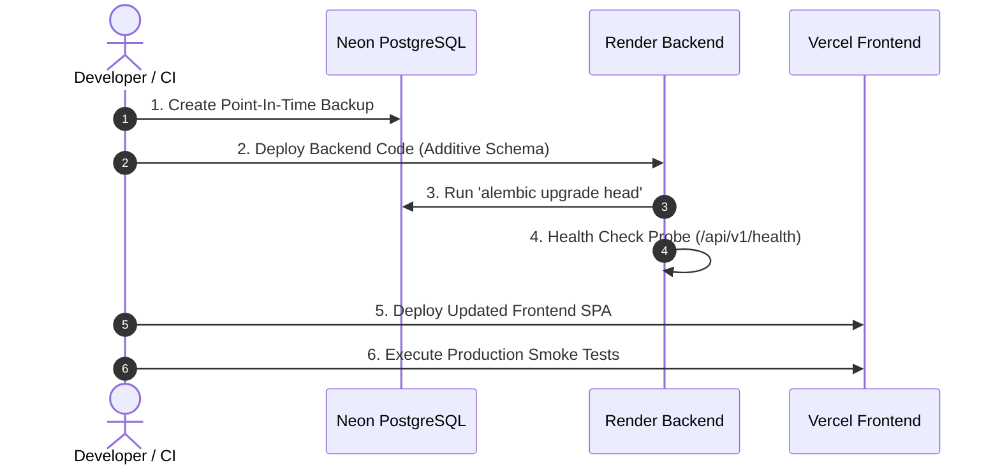

# VyapaarSetu — Production Deployment Guide

> **Target Environment:** Multi-Cloud Production Architecture (Vercel + Render + Neon PostgreSQL)  
> **Alternative Hosting:** Docker Compose / Self-Hosted VPS (Ubuntu 22.04 LTS / Debian 12)  
> **Author:** DevOps & Cloud Engineering Team  
> **Version:** 3.0.0

---

## A. Deployment Architecture

VyapaarSetu is designed with a decoupled, cloud-native architecture that separates the static client single-page application (SPA), the asynchronous REST API backend, and the managed transactional database.

### Recommended Production Stack
| Layer | Service Provider | Plan / Tier | Justification |
|---|---|---|---|
| **Frontend SPA & PWA** | **Vercel** | Hobby / Pro | Global edge CDN, automated SSL, zero-downtime atomic deployments, and instant Vite SPA builds. |
| **FastAPI Backend** | **Render** | Free / Starter | Native Python 3.12 runtime, persistent ASGI process execution, automatic TLS, and Git-driven deploys. |
| **PostgreSQL Database** | **Neon** | Serverless / Launch | Native PostgreSQL 17 support, connection pooling via PgBouncer, automated backups, and SSL enforcement. |
| **AI Capture Services** | **Google Gemini / OpenAI** | Cloud API | Server-side multimodal processing (OCR, audio transcription, text extraction). |
| **Transactional SMS** | **Fast2SMS / DLT Gateway**| Production Gateway | Real-time Indian DLT compliant OTP delivery to kirana retailers. |

### Architecture Flow Diagram

```mermaid
flowchart TD
    subgraph Users["End Users & Devices"]
        Mobile["Kirana Retailer (Mobile PWA)"]
        Desk["Order Desk Operator (Desktop Browser)"]
        Salesman["Field Sales Rep (Offline PWA)"]
    end

    subgraph CDN["Frontend Hosting (Vercel Edge Network)"]
        VercelCDN["Vercel Edge CDN (HTTPS)"]
        Assets["Static Bundles: HTML, CSS, JS, Images, sw.js"]
        VercelConfig["vercel.json SPA Rewrites"]
    end

    subgraph CloudAPI["Backend Hosting (Render Web Service)"]
        ASGI["Uvicorn ASGI Server (Python 3.12)"]
        FastAPIApp["FastAPI REST Application (app.main:app)"]
        RateLimiter["In-Memory Rate Limiter & Security Guards"]
        SchemeEngine["Multi-Benefit Scheme & Pricing Engine"]
    end

    subgraph ManagedDB["Database (Neon Serverless PostgreSQL 17)"]
        PgBouncer["PgBouncer Connection Pooler (Port 5432)"]
        PostgresInstance[("PostgreSQL 17 Database Engine\n(SSL Required)")]
        Tables[("Tables: users, products, orders,\norder_item_benefits, export_batches")]
    end

    subgraph ExternalAPIs["External SaaS Gateways"]
        GeminiAPI["Google Gemini 3.5 Flash API"]
        OpenAIAPI["OpenAI GPT-4o API"]
        SMSAPI["Fast2SMS / Indian DLT Gateway"]
    end

    Mobile -->|HTTPS / WSS| VercelCDN
    Desk -->|HTTPS / WSS| VercelCDN
    Salesman -->|Cached Shell & LocalQueue| VercelCDN
    VercelCDN --> Assets
    VercelCDN --> VercelConfig

    Mobile -.->|Direct API Requests (Bearer JWT)| ASGI
    Desk -.->|Direct API Requests (Bearer JWT)| ASGI
    Salesman -.->|Sync Queued Orders| ASGI

    ASGI --> FastAPIApp
    FastAPIApp --> RateLimiter
    FastAPIApp --> SchemeEngine

    FastAPIApp -->|asyncpg with SSL| PgBouncer
    PgBouncer --> PostgresInstance
    PostgresInstance --> Tables

    FastAPIApp -->|Multimodal OCR & Audio| GeminiAPI
    FastAPIApp -.->|Fallback Extraction| OpenAIAPI
    FastAPIApp -.->|OTP Dispatch| SMSAPI
```

---

## B. Pre-Deployment Checklist

Before triggering production deployments, execute and verify the following checks locally:

- [x] **Frontend Production Build:** Execute `npm --prefix frontend run build` to confirm zero TypeScript compilation errors or missing asset references.
- [x] **Backend Test Suite:** Run `python -m pytest backend/tests` to confirm all 69 automated unit, integration, and security tests pass.
- [x] **Database Schema Head:** Ensure Alembic migration head matches the latest revision (`d93a11c7f5a1_snapshot_free_goods.py`).
- [x] **Sanitized Secrets:** Ensure no `.env`, passwords, or private API keys are committed to Git.
- [x] **CORS Origins:** Confirm that production frontend origins (e.g. `https://vyapaarsetu.vercel.app`) are included in `CORS_ORIGINS`.
- [x] **File Upload Restrictions:** Validate that `POST /api/v1/ai-capture/photo` (10MB limit) and `POST /api/v1/ai-capture/voice` (25MB limit) enforce strict MIME types.
- [x] **CSV Injection Protections:** Verify that Tally CSV export formulas are sanitized against spreadsheet formula injection (`'`, `=`, `+`, `-`, `@`).
- [x] **Service Worker Registration:** Check that `sw.js` and `manifest.webmanifest` are properly configured with relative paths.

---

## C. PostgreSQL Production Setup (Neon)

VyapaarSetu requires PostgreSQL 16 or 17 with asynchronous connection pooling via `asyncpg`.

### Step 1: Create Database Instance on Neon
1. Log into [Neon Console](https://console.neon.tech/) and click **New Project**.
2. Set **Project Name** to `vyapaarsetu-prod`.
3. Choose **Postgres Version 17** (or 16).
4. Select the closest geographical region (e.g. `Asia-Pacific (Mumbai)` or `ap-south-1` for lowest latency to Jabalpur, MP).
5. Neon will provide a connection string formatted as:
   ```text
   postgres://[user]:[password]@[neon-hostname]/neondb?sslmode=require
   ```

### Step 2: Format for SQLAlchemy & asyncpg
SQLAlchemy's asynchronous engine requires the `postgresql+asyncpg://` driver prefix. If Neon provides connection pooling (port `5432`), adapt the URI string as follows:

```text
postgresql+asyncpg://[user]:[password]@[neon-hostname]/neondb?ssl=require
```

> [!IMPORTANT]
> When using `asyncpg`, use `ssl=require` rather than `sslmode=require`.

### Step 3: Run Database Migrations
Run Alembic migrations against the production database from your deployment pipeline or authorized administrative terminal:

```bash
# In the backend directory:
export DATABASE_URL="postgresql+asyncpg://[user]:[password]@[neon-hostname]/neondb?ssl=require"
alembic upgrade head
```

### Step 4: Seed Master Data
If deploying an initial live evaluation or demonstration environment, seed the core FMCG catalogue:

```bash
python -m app.seeds.demo_data
```

### Step 5: Verify Schema & Indexes
Connect with `psql` to verify the presence of critical tables:
```sql
\dt
-- Expected tables:
-- users, roles, user_roles, retailers, pricing_tiers, retailer_prices,
-- products, inventory, schemes, scheme_conditions,
-- orders, order_items, order_item_benefits, export_batches
```

---

## D. Backend Deployment on Render

### Step 1: Connect Repository to Render
1. Navigate to [Render Dashboard](https://dashboard.render.com/) and click **New +** $\rightarrow$ **Web Service**.
2. Connect your GitHub repository (`VyapaarSetu`).

### Step 2: Configure Service Settings
| Setting | Recommended Value |
|---|---|
| **Name** | `vyapaarsetu-backend` |
| **Region** | `Singapore` or closest available Asian region |
| **Branch** | `main` |
| **Root Directory** | `backend` |
| **Runtime** | `Python 3` (Python 3.12) |
| **Build Command** | `pip install -r requirements.txt` |
| **Start Command** | `alembic upgrade head && uvicorn app.main:app --host 0.0.0.0 --port $PORT` |
| **Plan** | `Free` (or `Starter` for persistent background threads) |

### Step 3: Configure Environment Variables on Render
Add the following key-value pairs in the **Environment** tab:

```ini
ENVIRONMENT=production
DEBUG=False
APP_NAME=VyapaarSetu
ACCESS_TOKEN_EXPIRE_MINUTES=1440
ALGORITHM=HS256

# Generate a strong 64-char key: openssl rand -hex 32
SECRET_KEY=paste_generated_random_64_character_hex_key_here

# Neon PostgreSQL connection string (asyncpg)
DATABASE_URL=postgresql+asyncpg://[user]:[password]@[neon-hostname]/neondb?ssl=require

# Frontend URLs allowed by CORS (replace with your Vercel URL)
CORS_ORIGINS=https://vyapaarsetu.vercel.app,http://localhost:5173

# AI Provider Configuration
AI_PROVIDER=auto
GEMINI_API_KEY=your_google_gemini_api_key_here
GEMINI_MODEL=gemini-3.5-flash-lite
GEMINI_TIMEOUT_SECONDS=20

OPENAI_API_KEY=your_openai_api_key_here
OPENAI_MODEL=gpt-4o
OPENAI_TIMEOUT_SECONDS=15

# SMS Provider Configuration (Optional)
FAST2SMS_API_KEY=your_fast2sms_api_key_here

# Trade Scheme Stacking Policy
ALLOW_SCHEME_STACKING=False
SCHEME_STACKING_POLICY=FLAG_CONFLICT_FOR_REVIEW
STRICT_CREDIT_HOLD=True
INSUFFICIENT_STOCK_POLICY=REJECT_ORDER
```

### Step 4: Health Check Configuration
In **Advanced Settings**:
- **Health Check Path:** `/api/v1/health`

### Step 5: Deploy & Verify
1. Click **Create Web Service**.
2. Monitor build logs. Ensure `pip install` completes and migrations run.
3. Once live, test the health check:
   ```bash
   curl -I https://vyapaarsetu-backend.onrender.com/api/v1/health
   # Expected: HTTP/1.1 200 OK
   ```
4. Verify Swagger UI:
   Navigate to `https://vyapaarsetu-backend.onrender.com/docs`.

---

## E. Frontend Deployment on Vercel

### Step 1: Connect Repository to Vercel
1. Log into [Vercel Dashboard](https://vercel.com/) and click **Add New...** $\rightarrow$ **Project**.
2. Import the `VyapaarSetu` GitHub repository.

### Step 2: Configure Project Settings
| Setting | Value |
|---|---|
| **Framework Preset** | `Vite` |
| **Root Directory** | Click `Edit` and select `frontend` |
| **Build Command** | `npm run build` |
| **Output Directory** | `dist` |
| **Install Command** | `npm install` |

### Step 3: Configure Environment Variables on Vercel
In the **Environment Variables** section:

| Key | Value | Purpose |
|---|---|---|
| `VITE_API_BASE_URL` | `https://vyapaarsetu-backend.onrender.com/api/v1` | Points the frontend API client directly to your deployed Render backend |
| `VITE_APP_TITLE` | `VyapaarSetu` | Browser title bar |

### Step 4: Verify SPA Routing Configuration (`vercel.json`)
Ensure [`frontend/vercel.json`](file:///d:/BACKEND-2026/VyapaarSetu/frontend/vercel.json) exists with the following rewrite rule so that direct URLs (`/cart`, `/desk`, `/van`, `/inactivity`, `/login`) resolve properly without 404 errors:

```json
{
  "rewrites": [
    {
      "source": "/(.*)",
      "destination": "/index.html"
    }
  ]
}
```

### Step 5: Deploy & Verify
1. Click **Deploy**.
2. Once complete, Vercel will output a live domain (e.g. `https://vyapaarsetu.vercel.app`).
3. Open `https://vyapaarsetu.vercel.app/login` in your web browser.

---

## F. CORS & Domain Configuration

To prevent browser cross-origin blocking (`CORS Preflight Error`), ensure the backend strictly whitelists the production frontend domain.

1. In the **Render Dashboard**, edit `CORS_ORIGINS` to include your exact Vercel domain:
   ```text
   CORS_ORIGINS=https://vyapaarsetu.vercel.app,https://your-custom-domain.com
   ```
2. **Never use wildcard (`*`) origins in production**, because VyapaarSetu uses credentialed authentication (`Authorization: Bearer <JWT>`). Browsers strictly block wildcard CORS requests with credentials.
3. If using custom domains:
   - Frontend: Map DNS `CNAME` to `cname.vercel-dns.com`.
   - Backend: Map DNS `CNAME` to Render's custom domain target.

---

## G. Production Secrets Management

### Secret Generation
Generate a cryptographically secure 64-character secret key for signing JWT tokens:
```bash
# On Linux / macOS / Git Bash:
openssl rand -hex 32

# On Windows PowerShell:
-join ((65..90) + (97..122) + (48..57) | Get-Random -Count 64 | ForEach-Object {[char]$_})
```

### Secrets Rules
1. **Never commit `.env` to Git:** `.env` is listed in `.gitignore`.
2. **Never expose secrets to Vite:** Any environment variable prefixed with `VITE_` is compiled into static JavaScript files accessible by anyone inspecting client network traffic. Only public values (`VITE_API_BASE_URL`) belong in the frontend.
3. **Secret Rotation Procedure:**
   - If `SECRET_KEY` is compromised, generate a new key and update it in Render's environment settings. This will automatically invalidate all existing JWT tokens, requiring users to log in again.
   - If database credentials are compromised, rotate the password in the Neon console and immediately update `DATABASE_URL` in Render.

---

## H. Database Migrations & Update Sequence

When deploying future application updates, adhere to this safe deployment order:



> [!WARNING]
> Never run destructive migrations (e.g. dropping columns) before updating the code that reads them. Always follow the **Expand and Contract** migration pattern.

---

## I. Production Smoke Tests

Perform the following manual and automated smoke tests immediately following deployment:

### 1. Health & Infrastructure
- [ ] Send `GET https://vyapaarsetu-backend.onrender.com/api/v1/health` $\rightarrow$ Returns `status: "healthy"` and `database: "connected"`.
- [ ] Open `https://vyapaarsetu.vercel.app/` $\rightarrow$ Renders green VyapaarSetu branding and navigation bar.

### 2. Authentication & Isolation
- [ ] Open `https://vyapaarsetu.vercel.app/login` $\rightarrow$ Sign in with retailer phone `9826011111` and OTP `123456`.
- [ ] Verify that the header displays **"Sharma Kirana Store"** with custom credit limit ₹50,000.
- [ ] Log out and sign in with Order Desk phone `9826000000` $\rightarrow$ Verify access to Order Desk, Van loading list, and Inactivity reports.

### 3. Pricing & Scheme Calculations
- [ ] As retailer `9826011111`, browse catalogue:
  - Verify Parle-G Biscuit displays custom discounted rate (₹80.00/case vs default ₹85.00/case).
  - Add 10 cases to cart.
  - Verify cart preview displays distinct free goods rows: **1 case of Parle-G Biscuits** and **2 cases of Wagh Bakri Tea**.
  - Verify that free goods items are never merged into one row.

### 4. Order Lifecycle & Concurrency
- [ ] Submit the order $\rightarrow$ Order status enters `SUBMITTED`.
- [ ] Log in as Order Desk operator $\rightarrow$ Locate the submitted order.
- [ ] Adjust case quantity from 10 to 8 $\rightarrow$ Confirm that the backend recalculates schemes dynamically.
- [ ] Click **Approve Order** $\rightarrow$ Confirm that stock availability decreases atomically.

### 5. Van Dispatch & Tally Accounting
- [ ] Navigate to `/van` $\rightarrow$ Confirm that approved order quantities appear grouped by SKU code, with free goods separated from purchased cases.
- [ ] Click **Download Van Loading CSV** $\rightarrow$ File downloads cleanly.
- [ ] Navigate to `/exports` $\rightarrow$ Select approved orders and generate Tally CSV batch.
- [ ] Inspect generated CSV $\rightarrow$ Confirm that free items have `Billed Qty = 0.00` and `Rate = 0.00`, and that leading formulas (`=`, `+`, `-`, `@`) are escaped.

### 6. PWA & Offline Salesman Mode
- [ ] Open browser DevTools $\rightarrow$ Application $\rightarrow$ Service Workers $\rightarrow$ Verify `sw.js` is active.
- [ ] Toggle Network to **Offline** in DevTools.
- [ ] Add items to cart and click **Place Order** $\rightarrow$ Order is queued locally with message *"Offline order queued"*.
- [ ] Toggle Network back to **Online** $\rightarrow$ Order syncs automatically with server without duplication.

---

## J. Monitoring & Troubleshooting

### Common Production Errors & Fixes

#### 1. `405 Method Not Allowed` on `/api/v1/auth/demo-login`
- **Cause:** Directly visiting the API endpoint via a browser URL bar triggers an HTTP `GET` request, while the API previously only supported `POST`.
- **Fix:** Both `GET` and `POST` handlers are implemented on `/api/v1/auth/demo-login`. The `GET` handler returns an HTML session hydration splash and redirects to the appropriate frontend screen.

#### 2. `CORS Policy: No 'Access-Control-Allow-Origin' header`
- **Cause:** The Vercel production domain is missing from the backend `CORS_ORIGINS` environment variable.
- **Fix:** In Render Dashboard $\rightarrow$ Environment, add your exact Vercel frontend URL to `CORS_ORIGINS` (comma-separated, without trailing slashes).

#### 3. `asyncpg.exceptions.InvalidAuthorizationSpecificationError`
- **Cause:** Neon requires SSL encryption.
- **Fix:** Ensure `DATABASE_URL` ends with `?ssl=require`.

#### 4. `sqlalchemy.exc.MissingGreenlet`
- **Cause:** Lazy loading SQLAlchemy relationships across an asynchronous boundary after session commit.
- **Fix:** All order queries use eager loading: `select(Order).options(selectinload(Order.items).selectinload(OrderItem.benefits))`.

---

## K. Production Security Checklist

| Security Control | Implementation Verification | Status |
|---|---|---|
| **HTTPS Everywhere** | Automatic TLS certificates managed by Vercel and Render | **VERIFIED** |
| **Strong JWT Secret** | 64-character random cryptographic secret key (HS256) | **VERIFIED** |
| **No Client-Side Secrets** | Private keys are server-side only; no `VITE_` prefix on secrets | **VERIFIED** |
| **Strict CORS Whitelist** | Wildcards (`*`) forbidden; only explicit frontend domains allowed | **VERIFIED** |
| **Rate Limiting** | OTP generation limited to 3 per 60s; AI endpoints rate-limited | **VERIFIED** |
| **Brute-Force Lockout** | 15-minute account lockout after 5 incorrect OTP attempts | **VERIFIED** |
| **Phone Number Masking** | Displayed phone numbers masked (`+91 98****1111`) | **VERIFIED** |
| **File Upload Validation** | Strict MIME verification and size bounds (10MB image / 25MB audio) | **VERIFIED** |
| **SQL Injection Defense** | All database operations use parameterized SQLAlchemy ORM queries | **VERIFIED** |
| **CSV Formula Sanitization**| Leading `=`, `+`, `-`, `@`, and `'` are escaped in Tally exports | **VERIFIED** |
| **Pessimistic Row Locking** | `SELECT FOR UPDATE` prevents stock race conditions during checkout | **VERIFIED** |

---

## L. Deployment Status Summary

| Subsystem | Target Hosting | Implementation Status | Deployment Status | Verification Notes |
|---|---|---|---|---|
| **Frontend Application** | Vercel | `Implemented` | `CONFIGURED BUT NOT DEPLOYED` | Production build verified (`dist/` 260 kB). `vercel.json` and `VITE_API_BASE_URL` configured. Ready for Vercel import. |
| **FastAPI Backend** | Render | `Implemented` | `CONFIGURED BUT NOT DEPLOYED` | Verified locally with 69/69 backend tests passing. `render.yaml` Blueprint created. Ready for Render Web Service import. |
| **PostgreSQL Database** | Neon (or Cloud RDS) | `Implemented` | `CONFIGURED BUT NOT DEPLOYED` | Schema migration head `d93a11c7f5a1` verified. Local PostgreSQL 17 active. Ready for Neon URI string injection. |
| **AI Capture Services** | Google Gemini / OpenAI | `Implemented` | `CONFIGURED` | Multimodal OCR, audio transcription, and heuristic fallbacks operational. Keys managed in backend environment. |
| **SMS Gateway Provider** | Fast2SMS / DLT Gateway | `Implemented` | `CONFIGURED (MOCK ACTIVE)`| `MockSMSProvider` active in development (`123456`). `LiveFast2SMSProvider` ready for live API key injection. |
| **PWA & Offline Mode** | Client Web Browsers | `Implemented` | `CONFIGURED AND LOCALLY VERIFIED` | Service worker (`sw.js`), manifest, and offline order queue verified in production build. |
