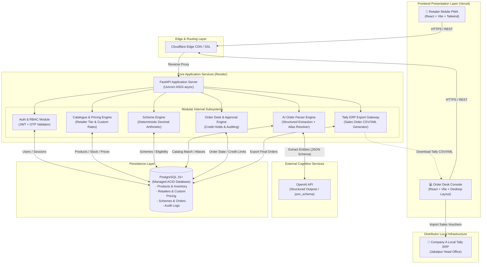
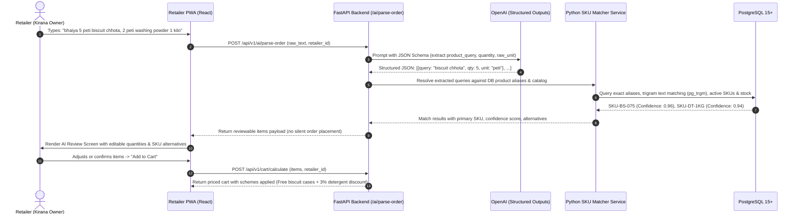
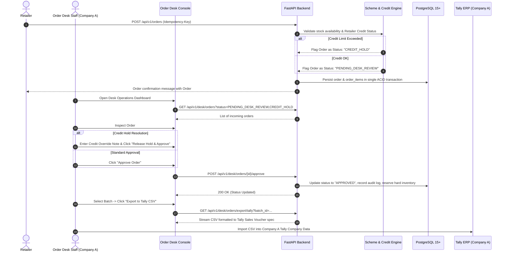

# VyapaarSetu — System Architecture Document
**Version:** 1.0.0 (Phase 0 Planning)  
**Author:** Principal Software Architect & Technical Lead  
**Client:** Company A, Jabalpur, Madhya Pradesh  

---

## 1. System Context & Overview

VyapaarSetu (व्यापार सेतु) is a B2B wholesale ordering platform connecting Company A (a distributor of 4 packaged food and home-care FMCG brands in Jabalpur, MP) with ~1,800 kirana retailers.

### Problem Context
The current ordering process relies heavily on unstructured communication channels:
- WhatsApp Hinglish messages (e.g., *"bhaiya 5 peti biscuit chhota, 2 peti washing powder 1 kilo, chai patti 250 wala 1 peti"*).
- Hindi audio voice notes sent over WhatsApp.
- Handwritten order slips photographed and sent via smartphone cameras.
- Direct phone calls to sales reps and order desk clerks.

Manual re-keying into Tally ERP results in human errors, delayed dispatches, unapplied retailer schemes, and inventory misalignment.

### Architectural Solution
VyapaarSetu resolves this via an intelligent hybrid architecture:
1. **Edge-Delivered Mobile-First Web PWA (Retailer Portal):** Built with React 18, Vite, TypeScript, and Tailwind CSS.
2. **Deterministic High-Throughput REST API (Backend Core):** Built with Python 3.11, FastAPI, SQLAlchemy 2.0 (async), and Pydantic v2.
3. **Relational ACID Core (Database):** Hosted on managed PostgreSQL 15+ (strictly relational; no document stores).
4. **AI Parsing & Server-Side Deterministic SKU Matching:** OpenAI Structured Outputs API extracting candidate entities, routed through a server-side fuzzy & alias-matching engine with human-in-the-loop review.
5. **Operational Order Desk & ERP Gateway:** Role-based desk interface with credit-limit guardrails and deterministic Tally ERP CSV/XML export.

---

## 2. Mermaid System Architecture Diagram

---

## 3. End-to-End Core Data Flows

### Flow 1: AI Natural Language Order Capture to Confirmed Cart

### Flow 2: Order Review, Credit Hold, Approval, and Tally Export

---

## 4. Subsystem Component Breakdown

### 4.1 Frontend Presentation Layer (React 18 + Vite + Tailwind CSS)
- **Retailer Experience (Mobile First):** Optimized for low-end Android devices on 3G/4G cellular connections. Sticky bottom navigation, high contrast typography (Inter + Noto Sans Devanagari), 48px+ tap targets, local cart persistence, and single-click AI Hinglish ordering.
- **Order Desk Experience (Desktop First):** High-density tabular layout, keyboard shortcuts, split-screen raw text vs structured SKU verification, inline quantity adjustments, and batch Tally export actions.

### 4.2 Backend API Core (FastAPI + SQLAlchemy 2.0 Async)
- **Strict Role-Based Access Control (RBAC):** JWT tokens with claims differentiating `retailer`, `order_desk`, and `admin`. Retailer requests are strictly scoped to their own `retailer_id`.
- **Decimal Financial Engine:** All monetary values (dealer prices, line totals, discounts, taxes) use Python's `Decimal` type to prevent binary floating-point roundoff errors.
- **Idempotency Protection:** Order creation endpoints require a unique client-generated `Idempotency-Key` header, preventing duplicate order placement during poor network reconnects.

### 4.3 Database Persistence Layer (Managed PostgreSQL 15+)
- Strictly relational schema.
- Foreign key constraints, unique indexes, and check constraints enforce data integrity at the database engine level.
- `JSONB` audit trails preserve exact raw AI inputs and state transitions without losing schema structure.
- Trigram similarity indexing (`pg_trgm`) accelerates server-side SKU and alias lookups.

### 4.4 External Cognitive Services (OpenAI API)
- Utilizes OpenAI's **Structured Outputs** (`response_format: { type: "json_object" }` or Pydantic JSON schema mode).
- Extracts only entities: product name query, quantity number, and raw unit.
- **Strict Rule:** The LLM is never permitted to determine prices, calculate subtotals, or verify stock availability. These are executed deterministically by Python services.

---

## 5. Security & Isolation Architecture

1. **Retailer Data Isolation:** Every query on retailer-specific resources enforces a mandatory `WHERE retailer_id = :current_user_retailer_id` clause extracted directly from the verified JWT payload. No retailer can access another retailer's pricing, cart, or order history.
2. **Deterministic Fallbacks:** If the OpenAI API is unreachable or experiences rate limits, the frontend gracefully falls back to direct catalogue browsing and search without crashing the ordering pipeline.
3. **Audit Trail Logging:** All changes to order line items, quantity modifications by desk operators, credit hold overrides, and approvals are written immutably to the `audit_logs` table.
4. **Environment Isolation:** Zero credentials or API keys stored in source control. All configuration parameters are strictly validated via Pydantic `BaseSettings` reading from environment variables.

