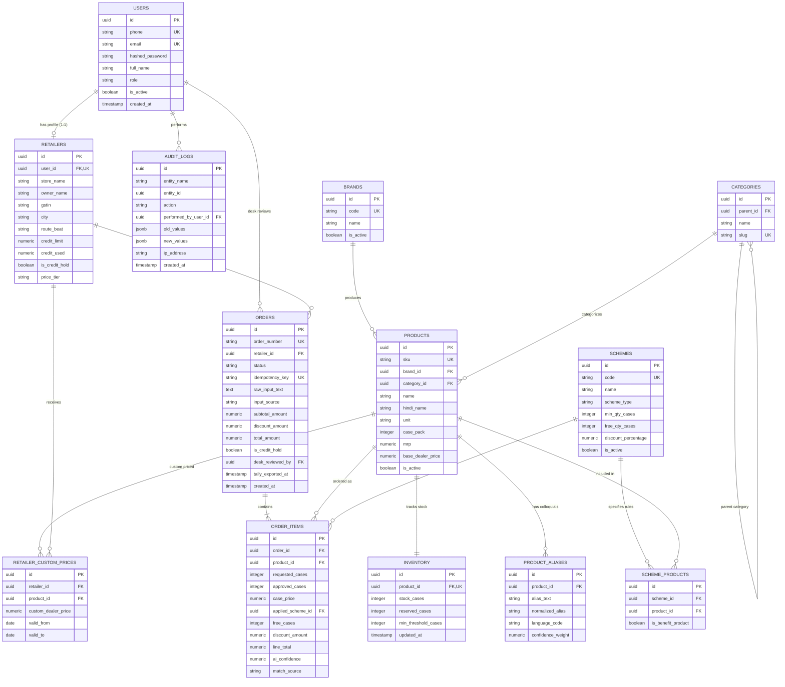

# VyapaarSetu — Entity Relationship Diagram (ERD)
**Version:** 1.0.0 (Phase 0 Planning)  
**Database Engine:** PostgreSQL 15+

---

## 1. Mermaid Entity Relationship Diagram

---

## 2. Cardinality & Foreign Key Cascade Rules

1. **`users` -> `retailers` (1:1):**
   - Deleting a user cascade-deletes the retailer record (`ON DELETE CASCADE`).
2. **`brands` -> `products` (1:N):**
   - Deleting a brand is strictly prohibited if active products reference it (`ON DELETE RESTRICT`).
3. **`products` -> `inventory` (1:1):**
   - Inventory is an automatic child record of product creation (`ON DELETE CASCADE`).
4. **`orders` -> `order_items` (1:N):**
   - Cascade delete only allowed if an order is cancelled before desk review (`ON DELETE CASCADE`).
5. **`retailers` -> `orders` (1:N):**
   - Retailer records with existing orders cannot be deleted; they can only be marked inactive (`ON DELETE RESTRICT`).

