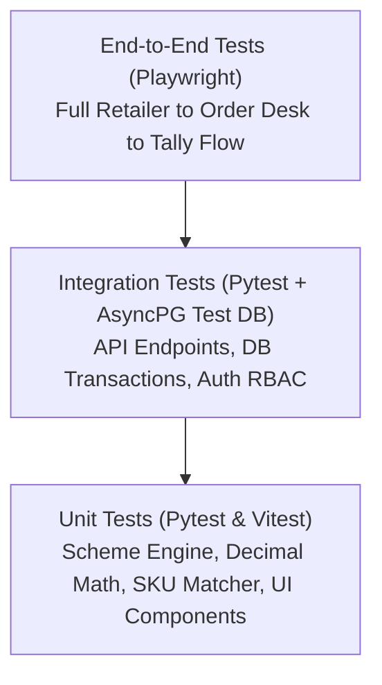

# VyapaarSetu — Comprehensive Testing Strategy
**Version:** 1.0.0 (Phase 0 Planning)  
**Standard:** No feature is marked complete based on mock claims. Every phase exit requires real, verified test runs.

---

## 1. Testing Pyramid & Tooling



| Test Type | Framework | Primary Scope | Target Coverage |
| :--- | :--- | :--- | :--- |
| **Backend Unit** | `pytest`, `pytest-asyncio` | Scheme calculation engine, Decimal arithmetic, SKU alias matcher, Pydantic validations | > 95% on business logic |
| **Backend Integration** | `pytest`, `httpx`, `asyncpg` | API routes, JWT authentication, PostgreSQL transaction rollback, Idempotency checks | > 85% on API handlers |
| **Frontend Unit/Component** | `vitest`, React Testing Library | Price formatting, Cart state reducer, Stepper controls, Confidence badges | > 80% on core components |
| **End-to-End (E2E)** | `playwright` | Critical path: Login -> AI Order Capture -> Review -> Checkout -> Desk Approval -> Tally Export | 100% on golden path |

---

## 2. Scheme Engine Test Matrix

The `SchemeEngine` is the financial core of VyapaarSetu. It must be tested with exhaustive boundary cases using `pytest.mark.parametrize`:

### Scheme A: Buy 10 Biscuit Cases Get 1 Free Case
- **Rule:** For every 10 cases of `SKU-BS-075`, add 1 free case of `SKU-BS-075`. Free cases do not increase the invoice payable amount.

| Test Case ID | Ordered Cases | Expected Free Cases | Billed Cases | Subtotal (at ₹777.60/case) | Net Payable | Note |
| :--- | :--- | :--- | :--- | :--- | :--- | :--- |
| `TC-SCH-A01` | 0 | 0 | 0 | ₹0.00 | ₹0.00 | Boundary: zero quantity |
| `TC-SCH-A02` | 9 | 0 | 9 | ₹6,998.40 | ₹6,998.40 | Below threshold (no free case) |
| `TC-SCH-A03` | 10 | 1 | 10 | ₹7,776.00 | ₹7,776.00 | Exact single threshold |
| `TC-SCH-A04` | 19 | 1 | 19 | ₹14,774.40 | ₹14,774.40 | Upper boundary before 2nd threshold |
| `TC-SCH-A05` | 20 | 2 | 20 | ₹15,552.00 | ₹15,552.00 | Exact double threshold |
| `TC-SCH-A06` | 35 | 3 | 35 | ₹27,216.00 | ₹27,216.00 | Multiple intervals |

### Scheme B: 3% Discount on 5 or more Detergent Cases
- **Rule:** If `SKU-DT-1KG` ordered cases >= 5, deduct a 3% discount from the detergent line subtotal.

| Test Case ID | Ordered Cases | Case Price (20 x ₹101.50) | Gross Subtotal | Discount % | Discount Amount | Net Line Total |
| :--- | :--- | :--- | :--- | :--- | :--- | :--- |
| `TC-SCH-B01` | 4 | ₹2,030.00 | ₹8,120.00 | 0% | ₹0.00 | ₹8,120.00 (Below threshold) |
| `TC-SCH-B02` | 5 | ₹2,030.00 | ₹10,150.00 | 3% | ₹304.50 | ₹9,845.50 (Exact threshold) |
| `TC-SCH-B03` | 10 | ₹2,030.00 | ₹20,300.00 | 3% | ₹609.00 | ₹19,691.00 (High volume) |

### Combined Cart Multi-Scheme Test
| Test Case ID | Cart Contents | Expected Free Items | Total Gross | Total Discounts | Expected Net Payable |
| :--- | :--- | :--- | :--- | :--- | :--- |
| `TC-SCH-COMB1`| 10 cases `SKU-BS-075` + 5 cases `SKU-DT-1KG` | 1 Free Case `SKU-BS-075` | ₹17,926.00 | ₹304.50 | ₹17,621.50 |

---

## 3. AI Order Capture & Parsing Test Cases

We utilize a deterministic mock for unit test execution to ensure tests run offline without consuming OpenAI API credits, while maintaining live integration tests for staging:

```python
# Sample test assertion target
sample_input = "bhaiya 5 peti biscuit chhota, 2 peti washing powder 1 kilo, chai patti 250 wala 1 peti"
```

| Test Case ID | Input Term | Expected SKU | Confidence Expected | Expected Stock Status |
| :--- | :--- | :--- | :--- | :--- |
| `TC-AI-01` | "biscuit chhota" | `SKU-BS-075` | >= 0.90 | In Stock (340 cases) |
| `TC-AI-02` | "washing powder 1 kilo" | `SKU-DT-1KG` | >= 0.90 | In Stock (85 cases) |
| `TC-AI-03` | "chai patti 250 wala" | `SKU-TE-250` | >= 0.85 | Out of Stock (0 cases) -> Flagged |
| `TC-AI-04` | "unrecognized sabun 5 peti" | `None` / Ambiguous | < 0.70 | Flagged as Unmatched / Needs Review |

---

## 4. End-to-End Playwright Workflow Test Scenarios

### E2E Scenario 1: Golden Path — Retailer Order to Tally Export
1. **Retailer Login:** Retailer enters `+919876543210` on mobile viewport, inputs test OTP `459012`. Verify redirect to catalogue.
2. **AI Order Entry:** Retailer navigates to Quick Order, pastes sample message: *"bhaiya 5 peti biscuit chhota, 2 peti washing powder 1 kilo"*. Clicks "Parse Order".
3. **Review & Quantity Correction:** Verify review screen shows Glucose Biscuit (5 cases) and Detergent (2 cases). Retailer increments Glucose Biscuit to 10 cases to trigger Scheme A. Clicks "Add to Cart".
4. **Cart Verification:** Verify cart renders 1 Free Case of Biscuit and total reflects valid Decimal sum. Clicks "Confirm Order".
5. **Desk Review:** Order Desk operator logs in on desktop viewport. Inspects incoming order # in "Pending Review" queue.
6. **Approval & Tally Export:** Operator reviews lines, approves order. Operator navigates to Tally Export console, triggers batch CSV download, and verifies CSV header and rows.

### E2E Scenario 2: Credit Hold Guardrail
1. Retailer with ₹25,000 credit limit and ₹20,000 credit used attempts to place an order worth ₹17,621.50.
2. Order is accepted with status `CREDIT_HOLD`.
3. Retailer sees banner: *"Order received. Placed on hold pending credit review."*
4. Desk operator sees order highlighted in `Credit Holds` tab with reason *"Exceeds credit limit by ₹12,621.50"*.
5. Desk operator enters override note: *"Cheque received in office"* and approves order.

---

## 5. Non-Negotiable Test Verification Rules

1. **No Mock Results in Reports:** We will never state "Tests passed" without running the actual test runner (`pytest` or `playwright test`) and capturing real execution logs.
2. **Transaction Rollback in Database Tests:** Every database integration test must run inside an isolated transaction that rolls back upon completion, ensuring zero data pollution between tests.
3. **Decimal Enforcement:** Any test involving currency calculations that compares using floating point (`== 17621.5`) instead of `Decimal('17621.50')` is considered a test bug and rejected in code review.

